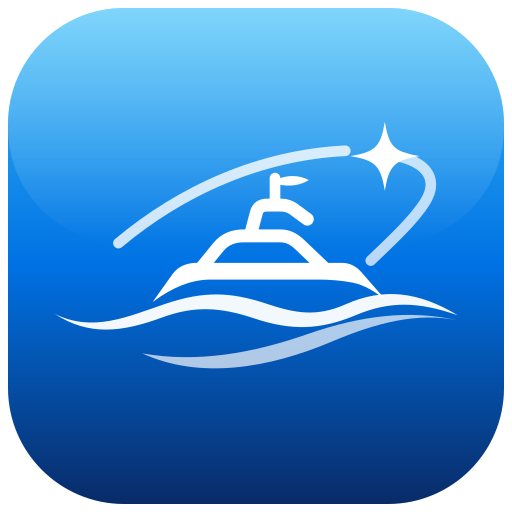

<div align="center">
  
  <h1>Ferry</h1>
  <p><strong>Big files. One scan. Zero storage.</strong></p>
  <p>
    <a href="https://ferry.kuberbassi.com"><strong>ferry.kuberbassi.com</strong></a>
  </p>
</div>

---

Direct browser-to-browser file transfer. Pick files or a folder, scan the QR, keep the tab open.

```
Sender Browser  ── WebRTC DataChannel (DTLS) ──▶  Recipient Browser
      │                                                   │
      └─────────── Rust + Axum WebSocket ─────────────────┘
                    (signalling only, 0 storage)
```

### Stack

- **Frontend** — React, TypeScript, Tailwind CSS, GSAP
- **Signalling** — Rust, Tokio, Axum, WebSockets

### Run Locally

Requires **Rust (Cargo)** and **Node.js 18+**.

```bash
git clone https://github.com/kuberbassi/ferry.git
cd ferry

# 1. Signalling server (:8787) — terminal 1
cd server && cargo run

# 2. Frontend (:5173) — terminal 2
cd web && npm install && npm run dev
```

### Deploy

Single-container build via `Dockerfile` (serves frontend + `/api` + `/ws` on `PORT=8787`).
